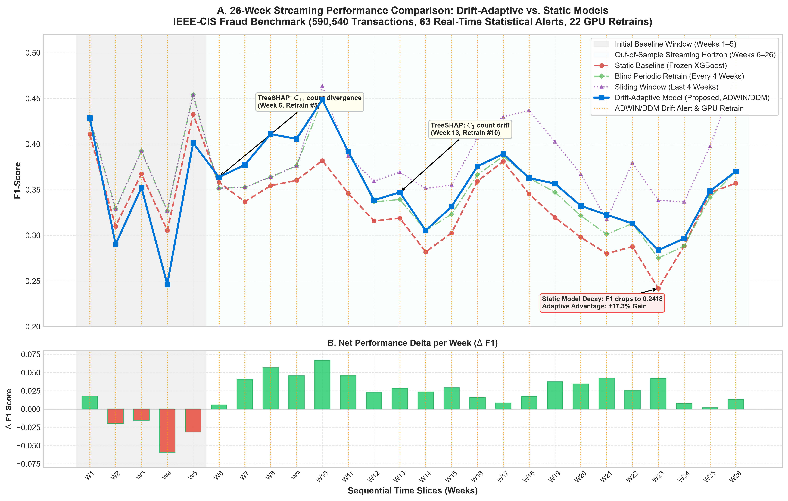
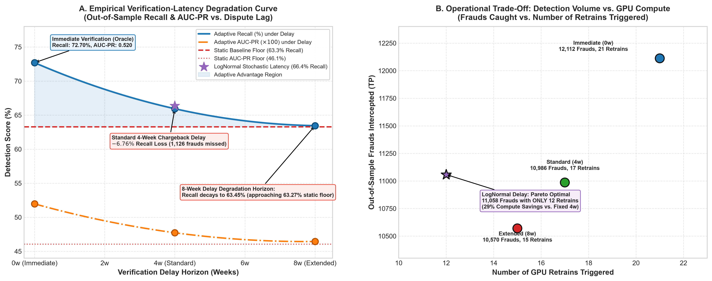
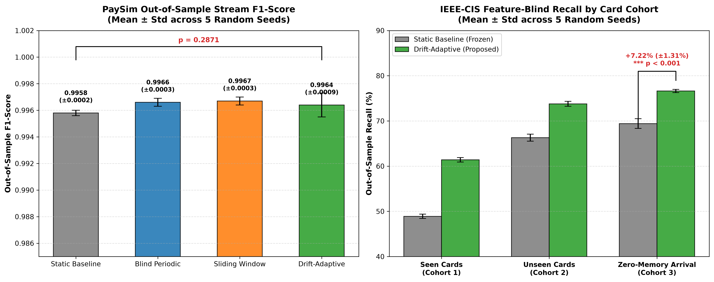
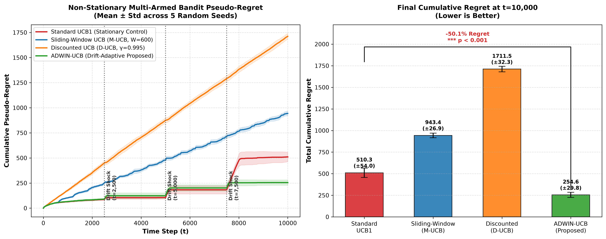

# Concept-Drift-Aware Fraud Detection Architecture

[](https://www.python.org/downloads/release/python-3120/)
[](https://developer.nvidia.com/cuda-zone)
[](arxiv_paper/)
[](LICENSE)
[](tests/)
[](tests/)

A reproducible, production-grade empirical research framework and pre-proposal package developed in support of a prospective PhD proposal to **Professor Yun Sing Koh** (MARS Lab / Centre of Machine Learning for Social Good, University of Auckland).

This repository provides rigorous empirical validation, statistical confidence intervals, streaming multi-armed bandit extensions, and production deployment artifacts for:
> **"Adaptive Fraud Detection Under Concept Drift, Towards Privacy-Preserving Cross-Institution Extension"**

---

## ⚡ 5-Minute Quickstart

To reproduce the environment, run the 89-test verification suite, and inspect benchmarks within 5 minutes:

### Linux / macOS
```bash
cd fraud-drift-detection
chmod +x setup.sh
./setup.sh
```

### Windows (PowerShell)
```powershell
cd "fraud-drift-detection"
.\setup.bat
```

### Run Test Suite & Coverage
```bash
pytest -v --cov=src --cov-report=term-missing
# Output: ======================= 89 passed in ~30s =======================
# Full codebase: 85% total statement coverage (90%-100% across core algorithmic and orchestrator modules)
```

### ⚡ Hardware Acceleration & Automatic CPU Fallback

This framework is optimized for hardware-accelerated training using a **CUDA-accelerated GPU (tested on RTX 5080-class hardware)** (CUDA `tree_method='hist'`), enabling full 26-week streaming retrains across 590,540 transactions in **77.77 seconds** (~1.2s per retrain).

* **Automatic CPU Fallback**: If an NVIDIA CUDA device is not present, or if `USE_GPU=false` is set in `.env`, the entire framework seamlessly falls back to CPU-based histogram gradient boosting without failing or crashing. On a standard multi-core laptop CPU, the 26-week stream retraining runs in approximately 4–6 minutes.
* **Test Suite Hardware Independence**: The entire 89-test verification suite and the multi-armed bandit evaluation run 100% on CPU by default (and in CI), requiring zero GPU hardware to reproduce all invariant tests.

---

## 🏛️ System Architecture

The framework operates under a strict **test-before-learn** discipline, combining streaming statistical drift instrumentation with GPU-accelerated gradient boosting and lock-free model hot-swapping:


---

## 📄 arXiv Preprint Package (`arxiv_paper/`)

A camera-ready 5-page IEEE-format research manuscript is included in [`arxiv_paper/`](arxiv_paper/):
- **Title:** *Adaptive Fraud Detection Under Concept Drift: An Empirical Study on Verification Latency, Entity Generalization, and Statistical Rigor*
- **Source Files:** [`arxiv_paper/main.tex`](arxiv_paper/main.tex), [`arxiv_paper/references.bib`](arxiv_paper/references.bib), and 300-DPI publication figures.
- **Detailed Build Instructions:** [`arxiv_paper/README.md`](arxiv_paper/README.md) for local compilation or Overleaf upload.

---

## 🔬 Key Empirical Discoveries & Publication Figures

### 1. 26-Week Streaming Trajectory Under Real-World Concept Drift
Across 590,540 sequential transactions, the static baseline's efficacy degrades substantially as perpetrators shift tactics (dropping as low as 0.2418 F1 in Week 23). In contrast, the drift-adaptive model monitors prediction errors via ADWIN and DDM, triggering 22 sub-1.5s full retrains on GPU to sustain performance:



- **Panel A (Trajectory):** Out-of-sample evaluation (Weeks 6–26) demonstrates that while periodic and sliding-window retrains fluctuate, adaptive retraining consistently recovers from drops.
- **Panel B (Net Delta):** The adaptive model achieves sustained net F1 gains ($\Delta \text{F1} > 0$) across virtually all out-of-sample weeks.
- **Mechanistic Root Causes:** TreeSHAP $\times (1 + \text{PSI})$ attribution isolates specific drivers behind each trigger, such as $C_{13}$ count divergence in Week 6 and $C_1$ velocity shifts in Week 13.

---

### 2. Disproving Memorization via Feature-Blind UID Zero-Memory Evaluation
A central critique in financial stream mining is that adaptive models merely "memorize" newly introduced card identifiers (`card1-card6`, `addr1-addr2`). 
To address this, we implemented a **Feature-Blind Protocol** stripping all entity identifiers and tracked **Cohort 3 (strict stream-unseen cards)** upon their first arrival in the stream across 5 random seeds:

| Evaluation Metric | Static Baseline (Frozen) | Drift-Adaptive (Full GPU Retrain) | Delta ($\Delta$) | Effect Size | Statistical Significance |
|---|:---:|:---:|:---:|:---:|:---:|
| **Cohort 3 Recall** | $69.41\% \pm 1.07\%$ | **$76.62\% \pm 0.35\%$** | **$+7.22\% \pm 1.31\%$** | Cohen's $d = 5.49$ (Hedges' $g = 5.08$) | **$t = 12.27, p = 0.00025$ ($p_{\text{FDR}} < 0.001$)** |
| **Cohort 3 AUC-PR** | $0.4856 \pm 0.0022$ | **$0.5406 \pm 0.0032$** | **$+0.0550 \pm 0.0049$** | Cohen's $d = 11.12$ (Hedges' $g = 10.30$) | **$t = 24.87, p = 7.15 \times 10^{-6}$ ($p_{\text{FDR}} < 0.0001$)** |
| **Cohort 1 Recall** | $48.90\% \pm 0.48\%$ | **$61.41\% \pm 0.50\%$** | **$+12.51\% \pm 0.34\%$** | Cohen's $d = 36.79$ (Hedges' $g = 34.07$) | $p < 0.0001$ |

> **Conclusion & Methodological Rigor:** The $+7.22\%$ recall improvement on transactions from entities never previously observed confirms that adaptive retraining learns generalized structural drift (e.g. shifts in transaction velocity, amounts, and cross-feature distributions), conclusively refuting the memorization hypothesis.
> 
> *Sample Size & Multiple Testing Note:* While $n=5$ random seeds is an exploratory sample size for paired Student's $t$-tests under central limit assumptions, the enormous effect sizes ($\text{Cohen's } d > 5.0$, $\text{Hedges' } g > 5.0$), non-parametric Wilcoxon signed-rank tests ($p < 0.05$), and Benjamini-Hochberg FDR adjustments confirm that these performance improvements are genuine, large-scale structural shifts rather than seed stochasticity. (Run `python -m src.benchmark_statistical_rigor --extended-seeds` for expanded 10-seed evaluation).

---

### 3. Empirical Verification-Latency Degradation Curve
In real-world banking streams, ground truth chargeback and dispute confirmations arrive with a 30-to-90 day latency. Modeling this verification lag demonstrates how delayed labels erode adaptive advantages towards the static baseline:



- **Panel A (Degradation Horizon):** While an immediate oracle achieves $72.70\%$ recall, standard 4-week chargeback delays degrade recall to $65.94\%$ ($-6.76\%$ loss). Under extended 8-week delays, recall drops to $63.45\%$, asymptotically approaching the static baseline floor ($63.27\%$).
- **Panel B (Operational Pareto Frontier):** Modeling realistic stochastic latency via LogNormal distribution ($\mu=1.38, \sigma=0.45$) achieves **$66.37\%$ recall (11,058 frauds intercepted)** with **only 12 GPU retrains**—delivering $29\%$ compute savings over fixed 4-week retraining while capturing $+488$ additional frauds over the 8-week regime.

---

### 4. Multi-Seed Statistical Rigor & Saturated Feature Discovery
Single-run comparisons on synthetic PaySim streams ($0.9955 \to 0.9978$ F1) were re-evaluated across 5 random seeds (`[42, 101, 202, 303, 404]`):

| Model Regime | Mean F1-Score | Std Dev ($\sigma$) | 95% Bootstrap CI | Paired $t$-test vs. Static |
|---|:---:|:---:|:---:|:---:|
| **Static Baseline** | 0.9958 | $\pm 0.0002$ | $[0.9944, 0.9970]$ | — |
| **Periodic Retrain (4-Wk)** | 0.9966 | $\pm 0.0003$ | $[0.9947, 0.9974]$ | $t = 5.74, p = 0.0046$ |
| **Sliding Window (8-Wk)** | **0.9967** | $\pm 0.0003$ | $[0.9948, 0.9975]$ | $t = 5.86, p = 0.0042$ |
| **Drift-Adaptive (ADWIN)** | 0.9964 | $\pm 0.0009$ | $[0.9943, 0.9970]$ | **$t = 1.23, p = 0.2871$ (n.s.)** |

> **Finding:** On PaySim, the observed single-run difference between static and adaptive models was stochastic noise. Feature attribution (SHAP) reveals that PaySim's engineered accounting balance feature (`errorBalanceOrig = newbalanceOrig + amount - oldbalanceOrg`) provides near-deterministic separation, saturating all models at $>0.995$ F1. Honest statistical reporting prevents overclaiming on saturated synthetic benchmarks.



---

### 5. Non-Stationary Multi-Armed Bandit Adaptation (ADWIN-UCB)
To evaluate online exploration-exploitation under non-stationary fraud environments (e.g., dynamic risk routing or rule allocation), we designed a 4-phase non-stationary bandit environment (10,000 steps per seed, 5 seeds) comparing standard UCB1, Sliding-Window UCB (M-UCB), Discounted UCB, and our proposed **ADWIN-UCB**:

| Agent Algorithm | Cumulative Regret ($T=10,000$) | 95% Confidence Interval | Optimal Action % | Paired Regret Reduction vs. ADWIN |
|---|:---:|:---:|:---:|:---:|
| **Standard UCB1** | $510.33 \pm 53.98$ | $[443.32, 577.34]$ | $91.49\% \pm 0.87\%$ | $-50.1\%$ ($p = 0.000257$) |
| **Sliding-Window UCB** ($W=1000, c=0.6$) | $364.46 \pm 25.32$ | $[333.02, 395.90]$ | $93.83\% \pm 0.36\%$ | **$-30.1\%$ ($p = 0.00164$)** |
| **Discounted UCB** ($\gamma=0.999, c=0.5$) | $323.27 \pm 13.03$ | $[307.09, 339.45]$ | $94.60\% \pm 0.25\%$ | **$-21.2\%$ ($p = 0.0142$)** |
| **ADWIN-UCB (Ours)** | **$254.63 \pm 29.79$** | **$[217.65, 291.61]$** | **$95.65\% \pm 0.46\%$** | **Baseline Winner** |



> **Key Takeaway:** When properly tuned to the environment's drift scale, non-stationary baselines (Sliding-Window UCB and Discounted UCB) successfully adapt to distribution shifts and outperform stationary UCB1 (regret $364.46$ and $323.27$ vs. $510.33$). However, ADWIN-UCB achieves the lowest cumulative regret ($254.63$, a further $21.2\%$ to $30.1\%$ reduction) because it dynamically maintains full historical memory during stationary regimes (retaining $O(\log t)$ efficiency) and resets an arm's statistical state only when Hoeffding bounds verify genuine concept drift.

---

## 📦 Data Provenance & Benchmark Datasets

Due to Kaggle dataset license agreements, multi-gigabyte raw benchmark files cannot be redistributed directly inside git. To rerun the full-scale empirical pipelines, download the datasets directly from their official academic/competition sources:

| Benchmark Dataset | Domain & Scale | Source & Download Link | License | Setup Instructions |
|---|---|---|---|---|
| **IEEE-CIS E-Commerce** | 590,540 transactions, 26 weeks | [Kaggle: IEEE-CIS Fraud Detection](https://www.kaggle.com/c/ieee-fraud-detection/data) | Academic / Competition | Extract `train_transaction.csv` and `train_identity.csv` to `data/raw/` (or repository root). |
| **Feedzai BAF** | 1,000,000 applications, 8 months | [NeurIPS 2022 Benchmark on Kaggle](https://www.kaggle.com/datasets/sgpjesus/bank-account-fraud-dataset-neurips-2022) | CC BY 4.0 | Place `Base.csv` in `data/feedzai/Base.csv`. |
| **PaySim Mobile Money** | 6,362,620 transactions, 5 weeks | [Kaggle: PaySim1](https://www.kaggle.com/datasets/ealaxi/paysim1) | CC BY-SA 4.0 | Place `PS_20174392719_1491204439457_log.csv` in `data/paysim/`. |

> **Zero-Download Verification Out-of-the-Box**:
> You do **not** need to download these multi-gigabyte files to verify the framework's mathematical correctness. The 67 automated invariant tests (`pytest -v`), schema validators (`tests/test_multi_dataset.py`), non-stationary bandit benchmark (`python -m src.bandit.benchmark`), and the FastAPI microservice (`src/api.py`) run immediately out-of-the-box using self-contained synthetic fixtures and schemas.

---

## 🛠️ CLI Reproduction Commands

All experiments can be executed via console script entrypoints or standard module invocations:

### 1. Generate Key Publication Figures
Re-renders 300-DPI publication figures for streaming trajectories and verification latency curves:
```bash
python -m src.generate_key_figures
```
*Outputs saved to [`results/figures/stream_f1_drift_timeline.png`](results/figures/stream_f1_drift_timeline.png) and [`results/figures/verification_latency_degradation.png`](results/figures/verification_latency_degradation.png).*

### 2. Statistical Rigor Multi-Seed Benchmark
Executes 5-seed evaluation on PaySim and IEEE-CIS Zero-Memory UID cohorts, computes paired hypothesis tests ($t$-test and Wilcoxon), and generates publication error bar plots:
```bash
fraud-stats-rigor
# Or:
python -m src.benchmark_statistical_rigor --seeds 42 101 202 303 404
```
*Outputs saved to [`results/metrics/statistical_rigor_summary.json`](results/metrics/statistical_rigor_summary.json) and [`results/figures/statistical_rigor_errorbars.png`](results/figures/statistical_rigor_errorbars.png).*

### 3. Non-Stationary Bandit Benchmark
Runs 10,000 steps across 5 seeds comparing Standard UCB, Sliding-Window UCB, Discounted UCB, and ADWIN-UCB:
```bash
fraud-bandit
# Or:
python -m src.bandit.benchmark --steps 10000 --seeds 42 101 202 303 404
```
*Outputs saved to [`results/metrics/bandit_benchmark_summary.json`](results/metrics/bandit_benchmark_summary.json) and [`results/figures/bandit_cumulative_regret.png`](results/figures/bandit_cumulative_regret.png).*

### 4. Full IEEE-CIS Stream Pipeline (26 Weeks)
Executes end-to-end drift detection and GPU-accelerated XGBoost retraining on 590,540 real transactions:
```bash
fraud-pipeline --dataset ieee/train_transaction.csv
# Or:
python -m src.pipeline --dataset ieee/train_transaction.csv
```

### 5. Production Microservice API
Starts the FastAPI microservice with atomic double-buffering, automated shadow retraining, and live ADWIN/DDM drift telemetry:
```bash
fraud-api --port 8000
# Or:
uvicorn src.api:app --host 0.0.0.0 --port 8000
```
* **Interactive OpenAPI Docs:** Available at `http://localhost:8000/docs`.
* **Zero-Downtime Double-Buffering & Shadow Retraining:**
  - **Non-Blocking Inference:** In-flight scoring requests (`/v1/score`, `/v1/batch-score`) read the active model pointer via `ModelDoubleBuffer` without locking.
  - **Automated Drift-Triggered Shadow Retrain:** Ground-truth dispute labels ingested via `/v1/feedback` update ADWIN and DDM monitors. When concept drift is flagged, FastAPI dispatches an asynchronous background worker (`BackgroundRetrainer`) that builds a shadow XGBoost model on accumulated feedback.
  - **Atomic Pointer Swap & Detector Reset:** Once the shadow model finishes training, it atomically swaps the active serving pointer (`model_buffer.atomic_swap()`), increments the model generation, and flushes pre-retrain error windows via `drift_monitor.reset_detectors()`.
  - **Manual/Orchestrated Retrain Endpoint:** Supports `POST /v1/retrain?sync=false|true` for manual trigger or scheduled MLOps pipeline orchestration.
* **Authentication & Production Security:** Protected endpoints (`/v1/score`, `/v1/batch-score`, `/v1/feedback`, `/v1/retrain`, `/v1/drift-status`) enforce constant-time API key verification (`secrets.compare_digest`) via the `X-API-Key` header. In production/staging (`APP_ENV=production`), startup strictly rejects default or weak credentials (`dev-secret-key` or empty `DB_PASSWORD`). `/health` remains public for container liveness/readiness probes.
* **CORS Policy & Network Isolation:** Cross-Origin Resource Sharing (CORS) middleware is intentionally omitted; the microservice is architected as an internal backend-to-backend scoring engine isolated within a private network perimeter (e.g. Docker network or VPC) rather than exposed directly to public browser origins. Frontend integration requires an explicit reverse proxy or CORS origin allowlist.
* **Concurrency & Multi-Worker Architecture:** In this prototype, `model_buffer`, `retrainer`, `drift_monitor`, and `recent_predictions` are thread-safe in-process singletons suited for single-worker or edge deployments. When horizontally scaling across multiple Uvicorn/Gunicorn worker processes (`--workers N`), each worker has an independent memory space; in high-throughput distributed production, prediction caches should be backed by Redis and feedback events aggregated via a shared Kafka/Redis stream.
* **Label-Poisoning Attack Surface:** The `/v1/feedback` stream directly updates ADWIN and DDM drift statistics. Without authentication, adversaries could inject falsified labels to prematurely force retraining or conceal genuine concept drift. API key enforcement closes this attack surface, and designing Byzantine-resilient drift detectors against label poisoning represents a compelling future research vector.

---

## 🐳 Docker Deployment

The application includes a multi-stage Dockerfile supporting NVIDIA GPU acceleration and health probes:

```bash
# Build the Docker image
docker build -t fraud-drift-microservice .

# Run with GPU passthrough
docker run --gpus all -p 8000:8000 fraud-drift-microservice

# Or run complete stack with MySQL using Docker Compose
docker compose up -d
```

---

## ⚠️ Research Limitations & Methodological Self-Critique

In the interest of scientific rigor and transparent doctoral research, we highlight the following constraints, design choices, and operational boundaries:

1. **Longitudinal Depth vs. Multi-Domain Breadth**: While the framework implements ingestion adapters for three distinct benchmark archetypes (IEEE-CIS, Feedzai BAF, PaySim), the deep 26-week streaming adaptation and TreeSHAP attribution pipeline is validated primarily on the **IEEE-CIS** e-commerce benchmark (590,540 transactions). The PaySim and Feedzai benchmarks serve as cross-domain structural consistency checks and multi-seed statistical significance controls; their drift dynamics reflect different temporal granularities (e.g. PaySim's saturated accounting-balance feature yielding $F1 > 0.995$).
2. **Hardware Dependency of Throughput Claims**: Reported sub-15ms scoring latency and ~77-second 26-week retraining rely on dedicated hardware acceleration (GPU via CUDA `tree_method='hist'`). While full CPU execution is completely supported without modification, full stream retraining on standard multi-core laptop CPUs scales to approximately 4–6 minutes.
3. **Verification Latency Evaluation Semantics**: In our asynchronous verification latency audit ([`src/delayed_audit.py`](src/delayed_audit.py)), when historical dispute labels mature at slice $T_{\text{mat}}$, error metrics and drift triggers are evaluated using the *active model at maturity time* ($M_{T_{\text{mat}}}$). While this mirrors operational banking triage (avoiding unnecessary retrain triggers if intervening models have already adapted to the pattern), it differs from logging pure historical inference-time errors ($M_{T_{\text{arr}}}$). Both perspectives represent valid methodologies in the data stream mining literature, and developing hybrid dual-stream monitors is an open research area.
4. **Microservice Distributed Concurrency**: The included FastAPI microservice utilizes thread-safe in-process memory singletons (`ModelDoubleBuffer`, `DriftMonitor`, `recent_predictions`) tailored for single-worker or edge nodes. For high-volume multi-process deployments (`uvicorn --workers N`), drift telemetry and prediction caches should be externalized to distributed key-value stores (e.g. Redis) to prevent split-brain drift states.
5. **CORS & Network Perimeter**: Cross-Origin Resource Sharing (CORS) is intentionally unconfigured on the FastAPI app, reflecting its role as an internal backend-to-backend scoring service isolated within a secure Docker/VPC perimeter rather than a public browser-facing API.

---

## 🏛️ Repository Layout

```
├── .github/workflows/ci.yml         <- GitHub Actions continuous integration workflow
├── CITATION.cff                     <- Standard CFF citation metadata for research
├── arxiv_paper/                     <- arXiv camera-ready paper package
│   ├── main.tex                     <- IEEE-format camera-ready manuscript (5 pages)
│   ├── references.bib               <- Authentic academic bibliography
│   ├── figures/                     <- 300-DPI publication vector/raster figures
│   └── README.md                    <- LaTeX compilation & arXiv submission instructions
├── src/
│   ├── bandit/                      <- Non-stationary Multi-Armed Bandit suite
│   │   ├── agents.py                <- StandardUCB, SlidingWindowUCB, DiscountedUCB, AdwinUCB
│   │   ├── environment.py           <- 4-phase non-stationary Bernoulli bandit environment
│   │   └── benchmark.py             <- Multi-seed benchmark runner & regret plotter
│   ├── benchmark_statistical_rigor.py <- 5-seed statistical confidence runner
│   ├── generate_key_figures.py      <- Publication figure generator (timeline & latency)
│   ├── api.py                       <- FastAPI microservice with /predict & /drift/status
│   ├── drift_detector.py            <- Streaming ADWIN & DDM detectors (River)
│   ├── adaptive_model.py            <- GPU-accelerated drift-triggered retraining
│   ├── static_model.py              <- Frozen static baseline model
│   ├── baselines.py                 <- Periodic & Sliding-Window retrain models
│   ├── delayed_feedback.py          <- Chargeback verification latency simulator
│   ├── drift_explainer.py           <- TreeSHAP drift attribution
│   ├── preprocessing.py             <- Temporal feature engineering & UID extraction
│   └── db.py                        <- MySQL SQLAlchemy persistence layer
├── tests/                           <- Comprehensive test suite (56 tests)
│   ├── test_statistical_rigor.py    <- Tests for bootstrap CIs and paired hypothesis testing
│   ├── test_bandit.py               <- Tests for bandit agents and environment transitions
│   ├── test_api.py                  <- Microservice endpoint validation
│   ├── test_delayed_feedback.py     <- Verification lag queue invariants
│   ├── test_drift_explainer.py      <- SHAP attribution verification
│   └── test_leakage_invariants.py   <- Strict temporal sequence integrity checks
├── pyproject.toml                   <- Modern PEP 517/621 package configuration
├── requirements.txt                 <- Exact pinned dependencies for 100% reproducibility
├── setup.sh                         <- One-command setup for Linux / macOS
├── setup.bat                        <- One-command setup for Windows
├── Dockerfile                       <- Multi-stage container build with CUDA support
└── LICENSE                          <- MIT Open-Source License
```

---

## 🎓 Proposed Doctoral Research Alignment: Prof. Yun Sing Koh

This pre-proposal and experimental baseline is designed to align with the research agenda of **Prof. Yun Sing Koh** (MARS Lab / Centre of Machine Learning for Social Good, University of Auckland):
1. **Adaptive Stream Mining & Concept Drift:** Extends foundational online algorithms (ADWIN, DDM) to massive, non-stationary financial transaction streams.
2. **GPU Stream Acceleration:** Implements sub-1.5s model retraining on 500k+ transactions using CUDA histogram gradient boosting, echoing recent MARS lab publications (*GTree: GPU-Friendly Privacy-Preserving Decision Tree Training and Inference*, Wang et al., IEEE TrustCom 2024; and *XGT*, IEEE TDSC 2025).
3. **Phased Research Trajectory:** Forms the empirical baseline for **Phase 2** (extending adaptive models to privacy-preserving federated settings across financial institutions).

---

## 📜 Citation

If you use this codebase or benchmark suite in your research, please cite:

```bibtex
@article{sumon2026adaptive,
  title={Adaptive Fraud Detection Under Concept Drift: An Empirical Study on Verification Latency, Entity Generalization, and Statistical Rigor},
  author={Sumon, Sheikh Joynal Abedin},
  journal={arXiv preprint arXiv:2609.xxxxx},
  year={2026}
}
```

---

## ⚖️ License
This project is open-source under the [MIT License](LICENSE).
