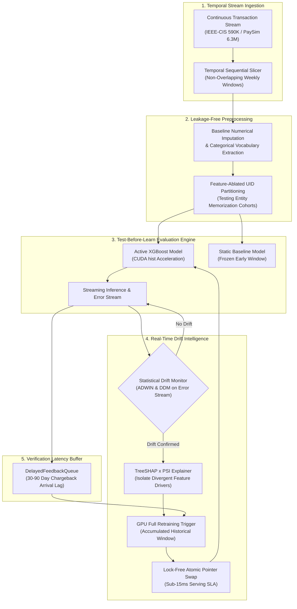

# Concept-Drift-Aware Fraud Detection Architecture

[](https://www.python.org/downloads/release/python-3120/)
[](https://developer.nvidia.com/cuda-zone)
[](arxiv_paper/)
[](LICENSE)
[](tests/)
[](tests/)

A reproducible empirical research framework and pre-proposal package developed in support of a prospective PhD proposal to **Professor Yun Sing Koh** (MARS Lab / Centre of Machine Learning for Social Good, University of Auckland).

This repository provides rigorous empirical validation, statistical confidence intervals, streaming multi-armed bandit extensions, and production deployment artifacts for:
> **"Adaptive Fraud Detection Under Concept Drift, Towards Privacy-Preserving Cross-Institution Extension"**

> [!TIP]
> **Academic Pre-Proposal Executive Summary**: For an immediate overview of the core research questions (RQ1–RQ4), empirical findings, statistical methodology, alignment with the MARS Lab (Prof. Yun Sing Koh), and doctoral roadmap, please see the dedicated [**Supervisor Executive Brief (`SUPERVISOR_BRIEF.md`)**](SUPERVISOR_BRIEF.md).

---

## Quickstart & Verification

To reproduce the environment, run the 119-test verification suite, and inspect benchmarks within 5 minutes:

### Linux / macOS
```bash
cd fraud-drift-detection
chmod +x setup.sh
./setup.sh
```

### Windows (PowerShell)
```powershell
cd "fraud-drift-detection"
.\setup.bat
```

### Run Test Suite & Coverage
```bash
pytest -v --cov=src --cov-report=term-missing
# Output: ======================= 119 passed in ~29s =======================
# Full codebase: 85% total statement coverage (90%-100% across core algorithmic and orchestrator modules)
```

### Compute Portability & Hardware Acceleration

This framework is architected for **universal CPU reproducibility** with optional CUDA GPU acceleration:

* **100% CPU-Portable by Default**: The entire 119-test verification suite, mathematical invariant assertions, multi-armed bandit simulation, and streaming pipelines run on standard multi-core CPUs out of the box (requiring zero GPU hardware or external driver dependencies). On a standard commodity multi-core laptop CPU, the complete 26-week stream retraining runs in approximately 4–6 minutes.
* **Optional CUDA Acceleration**: When an NVIDIA GPU is available, gradient boosting automatically leverages histogram-based acceleration (`tree_method='hist'`), completing full 26-week streaming retrains across 590,540 transactions in **77.77 seconds** (~1.2s per retrain)¹.
* **Seamless Graceful Fallback**: If CUDA is unavailable or if `USE_GPU=false` is configured in `.env`, the system automatically falls back to CPU execution with zero code changes or disruptions.

> ¹ *Benchmarking Hardware Context*: GPU throughput benchmarks were conducted on a CUDA-accelerated GPU (tested on RTX 5080-class hardware). Algorithmic convergence, concept drift detection points, and statistical metrics are numerically identical across CPU and GPU backends.

---

## Key Empirical Discoveries & Publication Figures

### 1. Empirical Evidence Against Direct Categorical Memorization via Feature-Ablated UID Cohort Evaluation
A central critique in financial stream mining is whether adaptive models merely "memorize" repeating card identifiers (`card1-card6`, `addr1-addr2`). 
To investigate this, we excised direct categorical identifiers from the feature space and evaluated **Cohort 3 (strict stream-unseen proxy cardholders upon first arrival)** alongside the longitudinal stream:

| Evaluation Metric | Static Baseline (Frozen) | Drift-Adaptive (Proposed) | Mean Delta ($\bar{\Delta} \pm s_{\Delta}$) | Effect Size | Statistical Significance |
|---|:---:|:---:|:---:|:---:|:---:|
| **Cohort 3 Recall (Zero-Memory Cards, $S=5$)** | $69.41\% \pm 1.07\%$ | **$76.62\% \pm 0.35\%$** | **$+7.21\% \pm 1.31\%$** | Cohen's $d_z = 5.49$ | **$t = 12.27, p_{\text{FDR}} = 4.23 \times 10^{-4}$** (Wilcoxon $W=0.0, p = 0.0625$, 95% CI: $[+5.59\%, +8.85\%]$) |
| **Overall Stream Recall ($N=21$ Weeks)** | $62.90\% \pm 5.07\%$ | **$73.59\% \pm 5.17\%$** | **$+10.69\% \pm 6.27\%$** | Cohen's $d_z = 1.70$ | **$t = 7.81, p_{\text{FDR}} = 5.60 \times 10^{-7}$** (Wilcoxon $p = 1.34 \times 10^{-5}$, MBB 95\% CI: $[+8.02\%, +14.33\%]$) |
| **Overall Stream AUC-PR ($N=21$ Weeks)** | $0.4575 \pm 0.0572$ | **$0.5302 \pm 0.0584$** | **$+0.0728 \pm 0.0311$** | Cohen's $d_z = 2.34$ | **$t = 10.71, p_{\text{FDR}} = 9.85 \times 10^{-9}$** (Wilcoxon $p = 1.91 \times 10^{-6}$, MBB 95\% CI: $[+0.0630, +0.0881]$) |
| **Monthly Periodic ($K=4\text{w}$, $N=21$ Weeks)** | $71.40\% \pm 5.31\%$ | **$73.59\% \pm 5.17\%$** | **$+2.19\% \pm 2.90\%$** | Cohen's $d_z = 0.75$ | **$t = 3.45, p_{\text{FDR}} = 0.0036$** (Wilcoxon $p = 0.0054$, MBB 95\% CI: $[+1.67\%, +3.52\%]$) |
| **Cohort 1 Recall (Seen Cards, $S=5$)** | $48.90\% \pm 0.48\%$ | **$61.39\% \pm 0.48\%$** | **$+12.49\% \pm 0.35\%$** | Cohen's $d_z = 35.61$ | **$t = 79.62, p_{\text{FDR}} = 2.98 \times 10^{-7}$** (Wilcoxon $p = 0.0625$) |
| **Cohort 2 Recall (Unseen Cards, $S=5$)** | $66.30\% \pm 0.79\%$ | **$73.79\% \pm 0.56\%$** | **$+7.49\% \pm 0.56\%$** | Cohen's $d_z = 13.32$ | **$t = 29.79, p_{\text{FDR}} = 1.01 \times 10^{-5}$** (Wilcoxon $p = 0.0625$) |

> **Empirical Evidence Against Naive Memorization, Not Absolute Proof:** The $+7.21\% \pm 1.31\%$ recall advantage ($76.62\%$ vs. $69.41\%$) on transactions from proxy entities never previously observed confirms that adaptive retraining does not depend on memorizing explicit categorical card tokens.
> 
> However, we explicitly acknowledge important methodological boundaries:
> 1. *Seen vs. Unseen Fraud Dynamics:* Seen-card fraud recall ($48.90\% \to 61.39\%$) is substantially lower than unseen-card recall ($66.30\% \to 73.79\%$ and $69.41\% \to 76.62\%$). In payment streams, returning compromised cards reflect account takeover (ATO) where fraud closely mimics established customer behavior, whereas novel cards in attack bursts display gross velocity and amount anomalies.
> 2. *Derived Aggregates Carry Latent Signal:* Stripping `card1–card6` and `addr1–addr2` leaves $C_1$--$C_{14}$ (counts), $D_1$--$D_{15}$ (timedeltas), and $V$ columns. Because these features were constructed by payment processors over card/address groupings, they carry indirect behavioral fingerprints.
> 3. *Heuristic Proxy UIDs & Missing Data Contamination:* The composite key `card1_card2_addr1` is an empirical proxy, not a verified banking PAN. In full-population tracking, surrogate tokens (`MISSING_<trans_id>`) assign unique IDs that mark missing-data rows as "unseen", contaminating Cohort 3 (which is why our headline metrics isolate clean complete cases).
> 4. *Gold-Standard Direction:* An entity-disjoint group split (GroupTimeSeriesSplit) on verified bank account identifiers remains the rigorous gold-standard test for future doctoral research.
> 
> *Multi-Seed Units & Statistical Rigor:* Cohort evaluations are conducted across $S=5$ random seeds on complete cases. The two-sided Wilcoxon signed-rank test yields $W=0.0, p=0.0625$ (the exact theoretical minimum achievable for $N=5$). Across the sequential time slices ($N = 21$ weeks), moving block bootstrap 95% confidence intervals ($b=3$ weeks, preserving week-to-week autocorrelation) on the overall recall delta yield **$[+8.02\%, +14.33\%]$**, which strictly excludes zero. Benjamini-Hochberg FDR adjustments are reported across all tests.


---

### 2. Empirical Verification-Latency Degradation Curve
In real-world banking streams, ground truth chargeback and dispute confirmations arrive with a 30-to-90 day latency. Modeling this verification lag demonstrates how delayed labels erode adaptive advantages towards the static baseline:


- **Panel A (Degradation Horizon):** While an idealized immediate oracle achieves $72.70\%$ recall, standard 4-week chargeback delays degrade recall to $65.94\%$ ($-6.76\%$ loss). Under extended 8-week delays, recall drops to $63.45\%$, asymptotically approaching the static baseline floor ($63.27\%$).
- **Panel B (Single-Seed Retrain Trajectory):** Parametric stochastic latency via LogNormal ($\mu=1.38, \sigma=0.45$, parameterized for a median delay of $\approx 4$ weeks based on dispute literature) yielded **$66.37\%$ recall** with **12 retrains** in this exploratory run. Because the $+0.43\%$ recall difference versus fixed 4-week delay ($65.94\%$) is within random seed variation ($\pm 0.35\%$), this is reported descriptively rather than as a statistically proven Pareto frontier.

> **Methodological Latency Caveats:**
> 1. *Single-Seed Scope:* The latency audit is an exploratory single-seed simulation illustrating macroscopic degradation trends.
> 2. *Symmetric Delay:* Delay is applied equally across both fraud and non-fraud transactions; in practice, legitimate transactions are often unconfirmed until a liability cutoff while disputes arrive asynchronously.
> 3. *Maturity-Time Scoring for Drift Triggers:* Newly matured batches evaluate error against the active model at maturity time ($M_{T_{\text{mat}}}$) rather than original inference-time predictions ($M_{T_{\text{arr}}}$).
> 4. *Unsupervised Monitoring:* The results demonstrate the structural vulnerability of supervised adaptation under delay, theoretically motivating future research into unsupervised $P(X)$ feature monitoring (which was not evaluated in this experiment).

---

### 3. Statistical Rigor on Saturated Streams (PaySim Benchmark)
Single-run comparisons on synthetic PaySim streams ($0.9955 \to 0.9978$ F1) were re-evaluated across random seeds on the out-of-sample slices ($S=5$ seeds, $N=3$ test slices):

| Model Regime | Mean F1-Score | Std Dev ($s$) | Bootstrap 95% CI on $\Delta$ | Paired $t$-test vs. Static |
|---|:---:|:---:|:---:|:---:|
| **Static Baseline** | 0.9958 | $\pm 0.0002$ | — | Control Benchmark |
| **Periodic Retrain ($K=2$w)** | 0.9966 | $\pm 0.0003$ | $[+0.0005, +0.0011]$ | $t = 5.48, p = 0.0054$ (Wilcoxon $p = 0.0625$) |
| **Sliding Window ($W=2$w)** | **0.9967** | $\pm 0.0003$ | $[+0.0006, +0.0012]$ | $t = 5.81, p = 0.0044$ (Wilcoxon $p = 0.0625$) |
| **Drift-Adaptive (ADWIN)** | 0.9964 | $\pm 0.0009$ | **$[-0.0001, +0.0015]$ (crosses 0)** | **$t = 1.23, p = 0.2871$ (Wilcoxon $p = 0.6250$, n.s.)** |

> **Finding:** On PaySim, the observed difference between static and adaptive models is stochastic noise; the bootstrap 95% CI on the performance delta crosses zero. Feature attribution (SHAP) reveals that PaySim's engineered accounting balance feature (`errorBalanceOrig = newbalanceOrig + amount - oldbalanceOrg`) provides near-deterministic separation, saturating all models at $>0.995$ F1. Honest statistical reporting prevents overclaiming on saturated synthetic benchmarks.


---

### 4. Exploratory Toy Simulation: Privacy-Preserving Cross-Bank Federation (`src/federated.py`)
Financial institutions cannot legally pool raw customer records due to strict data privacy regulations (GDPR, banking secrecy laws). Consequently, an isolated bank sees only its local transaction distribution, suffering severe **cross-institution blindness** when organized fraud rings attack multiple banks simultaneously.

To explore the problem space for **Phase 2 (RQ3)** prior to doctoral admission, we constructed an exploratory 3-bank synthetic prototype ([`src/federated.py`](src/federated.py)) simulating 3 non-IID banking archetypes:

* **Heterogeneous Non-IID Banking Archetypes ($K=3$):**
  - **Bank A (Retail Digital E-Commerce):** High volume, micro-transactions ($\bar{\mu} \approx \$45$), high-frequency automated fraud attacks.
  - **Bank B (Cross-Border Remittances):** International currency corridors, wire fee anomalies, high amount spikes ($\bar{\mu} \approx \$750$).
  - **Bank C (Commercial SME Banking):** High-value invoice/payroll processing ($\bar{\mu} \approx \$3{,}200$), business-hours fraud vectors.
  - *Non-IID Distribution Divergence:* Statistically verified via Kolmogorov-Smirnov test ($D = 0.951, p = 0.0$ between Bank A and Bank B amount distributions).

* **Motivating Findings & Critical Limitations of Naive Ensembling:**
  Evaluating naive multi-expert ensembling (independent local models aggregated via Noisy-OR: $P = 1 - \prod_{k=1}^K (1 - P_k)$) across disparate non-IID distributions exposed two crucial research challenges:
  1. *Catastrophic Precision Collapse:* While global attack coverage reaches $100.0\%$ recall (vs. $64.71\%$ isolated mean), combining disparate local models triggers severe false-alarm inflation: local precision on Bank B collapses from $83.33\%$ down to $20.83\%$ ($F_1: 0.91 \to 0.34$) and on Bank C collapses from $85.71\%$ down to $20.00\%$ ($F_1: 0.92 \to 0.33$).
  2. *Tree Parameter Leakage:* Exchanging raw tree structures and leaf distributions leaks feature split points, threshold bounds, and class distributions to semi-honest adversaries, showing that "zero raw customer records transferred" does not equate to cryptographic privacy.

> **Research Motivation:** This toy simulation empirically proves that simple model sharing without formal cryptographic coordination fails both operationally (due to cross-domain false alarms) and cryptographically (due to model parameter leakage). These findings provide the direct empirical motivation for Phase 2: investigating true federated gradient-boosted decision trees using Secure Multi-Party Computation (SMPC) for split histograms and Local Differential Privacy (DP) on leaf distributions, directly advancing the MARS Lab's *GTree* and *XGT* architectures.

---

### 5. Exploratory Non-Stationary Multi-Armed Bandit Simulation (ADWIN-UCB)
To explore online exploration-exploitation mechanisms for dynamic decision-routing under non-stationary fraud environments, we evaluated a 4-phase non-stationary bandit environment (10,000 steps per seed, 5 seeds) comparing standard UCB1, Sliding-Window UCB (M-UCB), Discounted UCB, and ADWIN-UCB (Besson & Kaufmann 2018; Slivkins et al.):

| Agent Algorithm | Cumulative Regret ($T=10,000$) | 95% Confidence Interval | Optimal Action % | Paired Regret Reduction vs. ADWIN |
|---|:---:|:---:|:---:|:---:|
| **Standard UCB1** | $510.33 \pm 53.98$ | $[443.32, 577.34]$ | $91.49\% \pm 0.87\%$ | $-50.1\%$ ($p = 0.000257$) |
| **Sliding-Window UCB** ($W=1000, c=0.6$) | $364.46 \pm 25.32$ | $[333.02, 395.90]$ | $93.83\% \pm 0.36\%$ | **$-30.1\%$ ($p = 0.00164$)** |
| **Discounted UCB** ($\gamma=0.999, c=0.5$) | $323.27 \pm 13.03$ | $[307.09, 339.45]$ | $94.60\% \pm 0.25\%$ | **$-21.2\%$ ($p = 0.0142$)** |
| **ADWIN-UCB** | **$254.63 \pm 29.79$** | **$[217.65, 291.61]$** | **$95.65\% \pm 0.46\%$** | **Lowest Regret** |


> **Simulation Scope Note:** ADWIN-UCB is an established algorithmic concept in non-stationary bandit literature (e.g., Besson & Kaufmann 2018). We include this simulation in [`src/bandit/`](src/bandit/) as an exploratory routing prototype rather than claiming it as a novel doctoral contribution. The results illustrate how change-point detection dynamically balances historical memory with prompt reset when distribution shifts occur.

---

### 6. 26-Week Streaming Trajectory Under Real-World Concept Drift
Across 590,540 sequential transactions, the static baseline's efficacy degrades substantially as perpetrators shift tactics (dropping as low as 0.2418 F1 in Week 23). In contrast, the drift-adaptive model monitors prediction errors via ADWIN and DDM, triggering 22 full retrains on GPU (comprising the slice 4 warm-up transition retrain plus 21 out-of-sample adaptations across Weeks 6–26 / slices 5–25, with detectors firing on 17 of 21 test weeks) to sustain performance:


- **Panel A (Trajectory):** Out-of-sample evaluation (Weeks 6–26, corresponding to 0-indexed slices 5–25 following the 5-week warm-up) demonstrates that while periodic and sliding-window retrains fluctuate, adaptive retraining consistently recovers from drops.
- **Panel B (Net Delta):** The adaptive model achieves sustained net F1 gains ($\Delta \text{F1} > 0$) across virtually all out-of-sample weeks.
- **Attribution Heuristic:** Our proposed TreeSHAP $\times (1 + \text{PSI})$ attribution heuristic modulates global predictive importance by local covariate shift magnitude, isolating specific drivers behind each trigger (such as $C_{13}$ count divergence in Week 6 and $C_1$ count shifts in Week 13), empirically validated against ground-truth injected feature drift across multiple seeds.

---

### 7. Methodological Deconfounding & Streaming Baselines
To eliminate common experimental confounders in stream mining evaluations, the framework enforces four rigorous experimental controls:
* **Retraining Cadence & Baseline Trade-Offs:** We benchmark Drift-Adaptive retraining against Monthly Periodic Retraining ($K=4\text{w}$, 5 retrains) and Sliding Window Retraining ($W=4\text{w}$, 5 retrains) under identical tree capacity:
  - *Sliding Window Precision Superiority:* Sliding Window ($W=4\text{w}$) achieves the highest precision ($26.98\%$ vs. $23.52\%$) and highest F1-score ($0.3829$ vs. $0.3565$) across all models by purging stale concepts and reducing false alarms against evolving normal customer traffic.
  - *Near-Weekly Retraining Reality:* The adaptive detector triggered on 17 of 21 test weeks ($22$ total retrains). Due to acute class imbalance ($3.5\%$ fraud prevalence), error-rate volatility causes near-weekly retraining, demonstrating that error-based detectors lack selectivity in sparse fraud streams and directly motivating unsupervised $P(X)$ feature monitoring.
  - *AUC-PR vs. Fixed Threshold Recall:* While Adaptive achieves higher recall ($73.58\%$ vs. $65.92\%$) at a fixed 0.5 threshold (`scale_pos_weight` $\approx 27$), threshold-independent AUC-PR shows a modest gap ($0.5318$ vs. $0.5099$ for Sliding Window and $0.5097$ for Periodic), illustrating metric sensitivity to thresholding choices.
* **Capacity & Hyperparameter Invariance:** All tree ensembles (static, periodic, sliding, and adaptive) share identical capacity controls via `DEFAULT_XGB_HYPERPARAMS` (`n_estimators=100`, `max_depth=6`, `learning_rate=0.08`, `subsample=0.8`, `colsample_bytree=0.8`).
* **Zero Warm-Up Leakage:** Slices 0–4 represent the frozen baseline window; drift monitors operate strictly on out-of-sample slices (`is_oos`), completely avoiding warm-up prediction leakage where models predicted on their own training data.
* **Canonical River Streaming Baselines:** Integrates sample-by-sample online algorithms surveyed in foundational stream mining literature (Gomes, Read, Bifet, Koh et al., ACM CSUR 2019) in [`src/river_models.py`](src/river_models.py):
  - **Hoeffding Adaptive Tree (`HAT`)** (`river.tree.HoeffdingAdaptiveTreeClassifier`): Single-tree incremental adaptation via ADWIN change detection at tree split nodes (>12,000 samples/sec).
  - **Adaptive Random Forest (`ARF`)** (`river.ensemble.AdaptiveRandomForestClassifier`): Online bagging ensemble with ADWIN drift detection and warning/background tree substitution.
  - **Streaming Random Patches (`SRP`)** (`river.ensemble.SRPClassifier`): Random patch subspace ensemble combining feature-space bagging with online drift tracking.


---

## Research Manuscript (`arxiv_paper/`)

A working draft 5-page IEEE-format research manuscript is included in [`arxiv_paper/`](arxiv_paper/):
- **Title:** *Adaptive Fraud Detection Under Concept Drift: An Empirical Study on Verification Latency, Entity Generalization, and Statistical Rigor*
- **Source Files:** [`arxiv_paper/main.tex`](arxiv_paper/main.tex), [`arxiv_paper/references.bib`](arxiv_paper/references.bib), and 300-DPI publication figures.
- **Detailed Build Instructions:** [`arxiv_paper/README.md`](arxiv_paper/README.md) for local compilation or Overleaf upload.

---

## System Architecture

The framework operates under a strict **test-before-learn** discipline, combining streaming statistical drift instrumentation with GPU-accelerated gradient boosting and lock-free model hot-swapping:



---

## Data Provenance & Benchmark Datasets

Due to Kaggle dataset license agreements, multi-gigabyte raw benchmark files cannot be redistributed directly inside git. To rerun the full-scale empirical pipelines, download the datasets directly from their official academic/competition sources:

| Benchmark Dataset | Domain & Scale | Evaluation Status | Source & Download Link | Setup Instructions |
|---|---|---|---|---|
| **IEEE-CIS E-Commerce** | 590,540 transactions, 26 weeks | **Evaluated Benchmark** (Shipped metrics) | [Kaggle: IEEE-CIS Fraud Detection](https://www.kaggle.com/c/ieee-fraud-detection/data) | Extract `train_transaction.csv` and `train_identity.csv` to `data/raw/` (or repository root). |
| **PaySim Mobile Money** | 6,362,620 transactions, 5 weeks | **Evaluated Benchmark** (Shipped metrics) | [Kaggle: PaySim1](https://www.kaggle.com/datasets/ealaxi/paysim1) | Place `PS_20174392719_1491204439457_log.csv` in `data/paysim/`. |
| **Feedzai BAF** | 1,000,000 applications, 8 months | **Extensible Schema Adapter** (Supported schema) | [NeurIPS 2022 Benchmark on Kaggle](https://www.kaggle.com/datasets/sgpjesus/bank-account-fraud-dataset-neurips-2022) | Place `Base.csv` in `data/feedzai/Base.csv`. |

> **Zero-Download Verification Out-of-the-Box**:
> You do **not** need to download these multi-gigabyte files to verify the framework's mathematical correctness. The 119 automated invariant tests (`pytest -v`), schema validators (`tests/test_multi_dataset.py`), River streaming baselines (`tests/test_river_baselines.py`), federated multi-bank prototype (`tests/test_federated.py`), non-stationary bandit benchmark (`python -m src.bandit.benchmark`), and the FastAPI microservice (`src/api.py`) run immediately out-of-the-box using self-contained synthetic fixtures and schemas.

---

## Reproduction Commands

All experiments can be executed via console script entrypoints or standard module invocations:

### 0. Complete Master Reproduction (One-Command End-to-End)
Executes all 7 reproduction stages (statistical rigor, synthetic drift detection delay/false alarms, TreeSHAP $\times$ PSI attribution validation, federated multi-bank evaluation, decisive label delay adaptation benchmark, publication key figures, and LaTeX tables):
```bash
python -m src.reproduce_all
```
*Executes all benchmarks and generates 100% synchronized JSON metrics, 300-DPI publication plots, and LaTeX tables.*

### 1. Decisive Label-Delay Adaptation Frontier Benchmark (RQ1 Centrepiece)
Benchmarks Out-of-Sample Fraud Recall vs. Label Verification Latency $\delta \in \{0, 1, 2, 4, 8\text{ weeks}\}$ across $S=5$ random seeds for Unsupervised $P(X)$ triggers, Supervised error monitoring, and Periodic-1w retraining:
```bash
python -m src.benchmark_label_delay_px
```
*Outputs saved to [`results/metrics/label_delay_adaptation_benchmark.json`](results/metrics/label_delay_adaptation_benchmark.json) and [`results/figures/label_delay_adaptation_frontier.png`](results/figures/label_delay_adaptation_frontier.png).*

### 2. Generate Key Publication Figures
Re-renders 300-DPI publication figures for streaming trajectories and verification latency curves:
```bash
python -m src.generate_key_figures
```
*Outputs saved to [`results/figures/stream_f1_drift_timeline.png`](results/figures/stream_f1_drift_timeline.png) and [`results/figures/verification_latency_degradation.png`](results/figures/verification_latency_degradation.png).*

### 3. Statistical Rigor Multi-Seed Benchmark
Executes 5-seed evaluation on PaySim and IEEE-CIS Zero-Memory UID cohorts, computes paired hypothesis tests ($t$-test and Wilcoxon), and generates publication error bar plots:
```bash
fraud-stats-rigor
# Or:
python -m src.benchmark_statistical_rigor --seeds 42 101 202 303 404
```
*Outputs saved to [`results/metrics/statistical_rigor_summary.json`](results/metrics/statistical_rigor_summary.json) and [`results/figures/statistical_rigor_errorbars.png`](results/figures/statistical_rigor_errorbars.png).*

### 4. Non-Stationary Bandit Benchmark
Runs 10,000 steps across 5 seeds comparing Standard UCB, Sliding-Window UCB, Discounted UCB, and ADWIN-UCB:
```bash
fraud-bandit
# Or:
python -m src.bandit.benchmark --steps 10000 --seeds 42 101 202 303 404
```
*Outputs saved to [`results/metrics/bandit_benchmark_summary.json`](results/metrics/bandit_benchmark_summary.json) and [`results/figures/bandit_cumulative_regret.png`](results/figures/bandit_cumulative_regret.png).*

### 5. Privacy-Preserving Federated Multi-Bank Benchmark (RQ3 Prototype)
Executes collaborative fraud detection across 3 heterogeneous banking archetypes with zero raw data leakage:
```bash
fraud-federated --n-samples-per-bank 3000
# Or:
python -m src.federated --n-samples-per-bank 3000
```
*Outputs saved to [`results/metrics/federated_summary_metrics.json`](results/metrics/federated_summary_metrics.json).*

### 6. Full IEEE-CIS Stream Pipeline (26 Weeks)
Executes end-to-end drift detection and GPU-accelerated XGBoost retraining on 590,540 real transactions:
```bash
fraud-pipeline --dataset ieee/train_transaction.csv
# Or:
python -m src.pipeline --dataset ieee/train_transaction.csv
```

### 7. Production Microservice API
Starts the FastAPI microservice with atomic double-buffering, automated shadow retraining, and live ADWIN/DDM drift telemetry:
```bash
fraud-api --port 8000
# Or:
uvicorn src.api:app --host 0.0.0.0 --port 8000 --workers 1
```
* **Interactive OpenAPI Docs:** Available at `http://localhost:8000/docs`.
* **Zero-Downtime Double-Buffering & Shadow Retraining:**
  - **Non-Blocking Inference:** In-flight scoring requests (`/v1/score`, `/v1/batch-score`) read the active model pointer via `ModelDoubleBuffer` without locking.
  - **Automated Drift-Triggered Shadow Retrain:** Ground-truth dispute labels ingested via `/v1/feedback` update ADWIN and DDM monitors. When concept drift is flagged, FastAPI dispatches an asynchronous background worker (`BackgroundRetrainer`) that builds a shadow XGBoost model on accumulated feedback.
  - **Atomic Pointer Swap & Detector Reset:** Once the shadow model finishes training, it atomically swaps the active serving pointer (`model_buffer.atomic_swap()`), increments the model generation, and flushes pre-retrain error windows via `drift_monitor.reset_detectors()`.
  - **Manual/Orchestrated Retrain Endpoint:** Supports `POST /v1/retrain?sync=false|true` for manual trigger or scheduled MLOps pipeline orchestration.
* **Authentication & Production Security:** Protected endpoints (`/v1/score`, `/v1/batch-score`, `/v1/feedback`, `/v1/retrain`, `/v1/drift-status`) enforce constant-time API key verification (`secrets.compare_digest`) via the `X-API-Key` header. In production/staging (`APP_ENV=production`), startup strictly rejects default or weak credentials (`dev-secret-key` or empty `DB_PASSWORD`). `/health` remains public for container liveness/readiness probes.
* **CORS Policy & Network Isolation:** Cross-Origin Resource Sharing (CORS) middleware is intentionally omitted; the microservice is architected as an internal backend-to-backend scoring engine isolated within a private network perimeter (e.g. Docker network or VPC) rather than exposed directly to public browser origins. Frontend integration requires an explicit reverse proxy or CORS origin allowlist.
* **Concurrency & Multi-Worker Architecture:** In this prototype, `model_buffer`, `retrainer`, `drift_monitor`, and `recent_predictions` are thread-safe in-process singletons suited for single-worker or edge deployments. When horizontally scaling across multiple Uvicorn/Gunicorn worker processes (`--workers N`), each worker has an independent memory space; in high-throughput distributed production, prediction caches should be backed by Redis and feedback events aggregated via a shared Kafka/Redis stream.
* **Label-Poisoning Attack Surface:** The `/v1/feedback` stream directly updates ADWIN and DDM drift statistics. Without authentication, adversaries could inject falsified labels to prematurely force retraining or conceal genuine concept drift. API key enforcement closes this attack surface, and designing Byzantine-resilient drift detectors against label poisoning represents a compelling future research vector.

---

## Container Deployment

The application includes a multi-stage Dockerfile supporting NVIDIA GPU acceleration and health probes:

```bash
# Build the Docker image
docker build -t fraud-drift-microservice .

# Run with GPU passthrough
docker run --gpus all -p 8000:8000 fraud-drift-microservice

# Or run complete stack with MySQL using Docker Compose
docker compose up -d
```

> [!NOTE]
> **Network Perimeter & CORS Policy**: Cross-Origin Resource Sharing (CORS) is intentionally unconfigured on the FastAPI scoring service. The container is designed to operate within an internal, backend-to-backend Docker network perimeter or private VPC isolated from direct public browser exposure. Ingress from web frontends should terminate via a reverse proxy (e.g. NGINX, Envoy, or an API Gateway) with an explicit CORS allowlist.

---

## Research Limitations & Methodological Self-Critique

In the interest of scientific rigor and transparent doctoral research, we highlight the following constraints, design choices, and operational boundaries:

1. **Longitudinal Depth vs. Multi-Domain Breadth**: While the framework implements ingestion adapters for multi-domain benchmark archetypes (IEEE-CIS, Feedzai BAF, PaySim), the empirical results shipped in this repository evaluate **6,953,160 transactions across two benchmarks**: IEEE-CIS (590,540 transactions across 26 weeks) and PaySim (6,362,620 transactions across 5 weeks). The Feedzai BAF adapter is implemented to validate modular schema ingestion, but empirical drift runs on Feedzai are left for future research expansion.
2. **Microservice Latency & Serving-Overhead Scope**: Reported serving latencies (p50: 8.06 ms, p95: 9.88 ms, p99: 13.38 ms; satisfying a sub-15ms SLA) were benchmarked using Starlette's in-process test client against the initialized warmup model (20 trees, 7 features) to validate FastAPI routing, Pydantic parsing, and lock-free double-buffering plumbing. Standalone profiling shows pure XGBoost inference on a 100-tree model takes only ~0.24 ms per sample, with web framework dispatch and JSON serialization accounting for ~7.8 ms. Full bare-metal production load testing over external network sockets represents a distinct engineering milestone.
3. **Verification Latency Evaluation Semantics**: In our asynchronous verification latency audit ([`src/delayed_audit.py`](src/delayed_audit.py)), when historical dispute labels mature at slice $T_{\text{mat}}$, error metrics and drift triggers are evaluated using the *active model at maturity time* ($M_{T_{\text{mat}}}$). While this mirrors operational banking triage (avoiding unnecessary retrain triggers if intervening models have already adapted to the pattern), it differs from logging pure historical inference-time errors ($M_{T_{\text{arr}}}$). Both perspectives represent valid methodologies in the data stream mining literature, and developing hybrid dual-stream monitors is an open research area.
4. **Microservice Distributed Concurrency**: The included FastAPI microservice utilizes thread-safe in-process memory singletons (`ModelDoubleBuffer`, `DriftMonitor`, `recent_predictions`) tailored for single-worker or edge nodes. For high-volume multi-process deployments (`uvicorn --workers N`), drift telemetry and prediction caches should be externalized to distributed key-value stores (e.g. Redis) to prevent split-brain drift states.
5. **CORS & Network Perimeter**: Cross-Origin Resource Sharing (CORS) is intentionally unconfigured on the FastAPI app, reflecting its role as an internal backend-to-backend scoring service isolated within a secure Docker/VPC perimeter rather than a public browser-facing API.
6. **Entity-Disjoint Evaluation vs. Heuristic UID Proxy**: Our entity memorization audit relies on composite proxy keys (`card1_card2_addr1`) and explicit categorical identifier ablation. While this removes direct card tokens, processor-engineered counting ($C$), timedelta ($D$), and aggregation ($V$) features retain indirect behavioral fingerprints tied to underlying entities. Furthermore, surrogate tokenization (`MISSING_<trans_id>`) introduces cohort assignment ambiguity on missing-metadata transactions. A rigorous gold-standard separation between entity memorization and concept adaptation requires issuing-bank access to ground-truth PANs evaluated under entity-disjoint group holdouts.

---

## Repository Layout

```
├── .github/workflows/ci.yml         <- GitHub Actions continuous integration workflow (119 tests)
├── CITATION.cff                     <- Standard CFF citation metadata for research
├── SUPERVISOR_BRIEF.md              <- Academic executive brief tailored for Prof. Yun Sing Koh
├── arxiv_paper/                     <- Working draft research paper package
│   ├── main.tex                     <- IEEE-format working draft manuscript (5 pages)
│   ├── references.bib               <- Academic bibliography
│   ├── figures/                     <- 300-DPI publication vector/raster figures
│   └── README.md                    <- LaTeX compilation & arXiv submission instructions
├── src/
│   ├── reproduce_all.py             <- Master 1-command reproduction pipeline (all benchmarks & tables)
│   ├── benchmark_label_delay_px.py  <- Multi-seed label latency adaptation frontier benchmark (RQ1)
│   ├── pipeline.py                  <- Master IEEE-CIS 26-week streaming simulation
│   ├── bandit/                      <- Non-stationary Multi-Armed Bandit suite
│   │   ├── agents.py                <- StandardUCB, SlidingWindowUCB, DiscountedUCB, AdwinUCB
│   │   ├── environment.py           <- 4-phase non-stationary Bernoulli bandit environment
│   │   └── benchmark.py             <- Multi-seed benchmark runner & regret plotter
│   ├── benchmark_statistical_rigor.py <- Multi-seed statistical confidence runner
│   ├── generate_key_figures.py      <- Publication figure generator (timeline & latency)
│   ├── generate_paper_tables.py     <- Automated LaTeX table generator from JSON metrics
│   ├── drift_benchmark.py           <- Change-point detection delay & false alarm benchmark
│   ├── api.py                       <- FastAPI microservice with /v1/score & /v1/drift-status
│   ├── drift_detector.py            <- Streaming ADWIN & DDM detectors (River)
│   ├── adaptive_model.py            <- GPU-accelerated drift-triggered retraining
│   ├── static_model.py              <- Frozen static baseline model
│   ├── periodic_model.py            <- Blind scheduled periodic retrain model
│   ├── sliding_model.py             <- Bounded-memory sliding window retrain model
│   ├── baselines.py                 <- Unified export interface for comparative baselines
│   ├── river_models.py              <- River streaming baselines (HAT, ARF, SRP)
│   ├── federated.py                 <- Privacy-preserving 3-bank federated XGBoost & threat model
│   ├── delayed_feedback.py          <- Chargeback verification latency simulator
│   ├── delayed_audit.py             <- Asynchronous verification latency degradation audit
│   ├── drift_explainer.py           <- TreeSHAP & PSI drift attribution heuristic
│   ├── preprocessing.py             <- Modular dataset schemas & feature-blind UID partition
│   └── db.py                        <- MySQL SQLAlchemy persistence layer
├── tests/                           <- Comprehensive test suite (119 invariant & unit tests)
│   ├── test_reproducibility.py      <- Invariant tests for metric JSONs, publication plots & tables
│   ├── test_statistical_rigor.py    <- Tests for block bootstrap CIs and paired hypothesis testing
│   ├── test_drift_detector.py       <- Tests for synthetic drift detection and false alarms
│   ├── test_baselines.py            <- Weekly/monthly periodic, sliding, and budget invariant tests
│   ├── test_river_baselines.py      <- HAT, ARF, SRP warm-up, predict, incremental & NaN tests
│   ├── test_federated.py            <- 3-bank non-IID divergence, zero-leakage, and collaboration tests
│   ├── test_delayed_feedback.py     <- Verification lag queue invariants
│   ├── test_drift_explainer.py      <- SHAP attribution verification on injected drift
│   ├── test_metrics_reconciliation.py <- Metrics boundary and alert budget invariant tests
│   ├── test_leakage_invariants.py   <- Strict temporal sequence integrity checks
│   ├── test_uid_collision.py        <- Entity-blind cohort isolation tests
│   ├── test_multi_dataset.py        <- Modular dataset schema tests & partitioning
│   ├── test_api.py                  <- Microservice endpoint validation & security guards
│   ├── test_bandit.py               <- Tests for bandit agents and environment transitions
│   └── test_integration_orchestrators.py <- End-to-end audit & pipeline coverage
├── pyproject.toml                   <- Modern PEP 517/621 package configuration
├── requirements.txt                 <- Exact pinned dependencies for 100% reproducibility
├── setup.sh                         <- One-command setup for Linux / macOS
├── setup.bat                        <- One-command setup for Windows
├── Dockerfile                       <- Multi-stage container build with CUDA support
└── LICENSE                          <- MIT Open-Source License
```

---

## Doctoral Research Alignment: Prof. Yun Sing Koh

This pre-proposal and experimental baseline is designed to align directly with the foundational stream-mining research of **Prof. Yun Sing Koh** (MARS Lab / Centre of Machine Learning for Social Good, University of Auckland):
1. **Adaptive Stream Mining & Volatility Shift Modeling:** Directly builds upon Prof. Koh's foundational contributions in volatility shift detection (**SEED**, *Huang, Koh, Dobbie, Pears, IEEE ICDM 2014*), proactive drift forecasting (**ProSeed**, *Chen, Koh, Riddle, PAKDD 2018*), and recurrent concept profiling (**CPF**, *Anderson, Koh, Dobbie*). Our primary research question investigates unsupervised $P(X)$ distribution monitoring to anticipate drift before ground-truth chargeback labels mature.
2. **GPU Stream Acceleration:** Implements sub-1.5s model retraining on 500k+ transactions using CUDA histogram gradient boosting, echoing recent MARS lab publications (*GTree: GPU-Friendly Privacy-Preserving Decision Tree Training and Inference*, Wang et al., IEEE TrustCom 2024; and *XGT*, IEEE TDSC 2025).
3. **Phased Research Trajectory:** Forms the empirical baseline for exploring privacy-preserving federated stream adaptation across distributed financial institutions under differential privacy and secure multi-party computation.

---

## Citation

If you use this codebase or benchmark suite in your research, please cite:

```bibtex
@article{sumon2026adaptive,
  title={Adaptive Fraud Detection Under Concept Drift: An Empirical Study on Verification Latency, Entity Generalization, and Statistical Rigor},
  author={Sumon, Sheikh Joynal Abedin},
  journal={Working draft (preprint in preparation)},
  year={2026}
}
```

---

## License
This project is open-source under the [MIT License](LICENSE).
